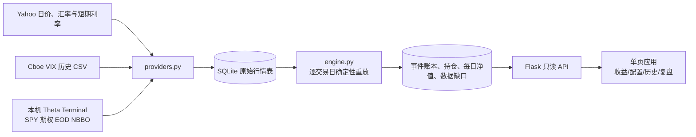

# 系统架构

本项目沿用参考项目的 Flask、原生 JS 单页和紫金色复盘卡片形式，但只提供本地日终报价模拟。实盘账户、个人交易 JSON、GitHub Pages 预计算和云端密钥不在本项目范围内。

## 数据流

原始表为 `bars`、`option_quotes`、`fx`、`rates`。衍生表为 `events`、`daily_nav`、`open_positions`、`data_gaps`。衍生表在同一 SQLite 事务中重建，因此相同原始数据和规则版本重复重放不会复制事件。

历史模型回测使用独立的 `data/backtest-2y.sqlite3`（以及按需生成的 `backtest-10y.sqlite3`）。其中同样归档真实市场输入，但期权报价由 CRR 模型生成并标注 `MODEL_BACKTEST` 与模型版本；它不能与 `tianfu.sqlite3` 的 Theta EOD 真实报价事件混用。

## 模块边界

| 路径 | 职责 |
|---|---|
| `strategy/providers.py` | 逐标的日价、Cboe VIX、Theta EOD 报价归档；拒绝倒挂或无效报价 |
| `strategy/calendar.py` | NYSE 常规完整休市日与最新可发布交易日 |
| `strategy/pricing.py` | 含股息 CRR 美式期权模型、报价中价反推波动率与 Delta |
| `strategy/engine.py` | 备兑额度、阶梯、止盈、接货、房东模式、保险、分红、逐日盯市 |
| `strategy/db.py` | SQLite 模式与原始行情写入接口 |
| `manage.py` | 初始化、回填、每日增量同步、重放及状态检查 |
| `server.py` | 启动后台补漏与五个只读 API |
| `js/common.js`、`js/tabs/*.js` | 公共格式化与四个页面模块，浏览器直接加载 ES modules |
| `js/main.js` | Hash 导航、数据状态提示和页面装配 |

## API

五个 API 均返回 `as_of`、`rule_version`、`simulation`、`status`。`as_of` 仅在完整交易日发布。`/api/trades` 将事件和原始合约 bid/ask 关联，显示模型 Delta、报价日期和来源。

| 路径 | 主要内容 |
|---|---|
| `/api/overview` | 最新净值、现金流、日度曲线及月度收益归因/提取视图 |
| `/api/allocation` | BOXX、SPY、现金、长保险、空头负债、当前期权持仓 |
| `/api/trades` | `view=orders` 汇总期权与股票持仓批次的开平仓，`view=events` 返回分页成交、指派、提取及跳过信号 |
| `/api/review` | 策略事件计数、欠额和数据缺口 |
| `/api/data-health` | 各标的覆盖日期、期权覆盖日期及过期状态 |
| `/api/backtests/2` | 独立两年模型回测指标、净值、回撤、月度收益归因及 QQQ/QQQI 链式基准 |
| `/api/backtests/2/trades` | 独立模型回测事件及每笔模型报价参数；`view=orders` 返回期权和股票的开平仓订单汇总 |

## 运行方式

`python3 run.py` 按需安装依赖、启动 `server.py` 并打开浏览器。服务启动时后台补漏，页面可先读取上一次完整结果。macOS LaunchAgent 每日调用 `scripts/daily-update.sh`；手动运行 `python3 manage.py daily` 使用相同同步流程。

缺少真实 Theta 报价时不构造模拟收益。行情更新失败时保留上一完整账本，页面显示数据缺口或过期状态。实际本机 LaunchAgent 对 `Documents` 目录的后台读取权限还需由 macOS 授权，见 [README.md](README.md)。
